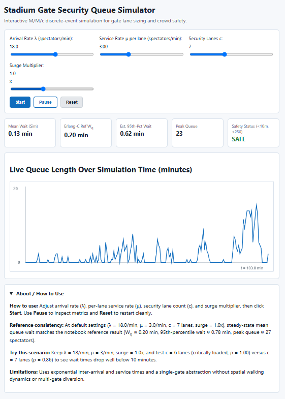
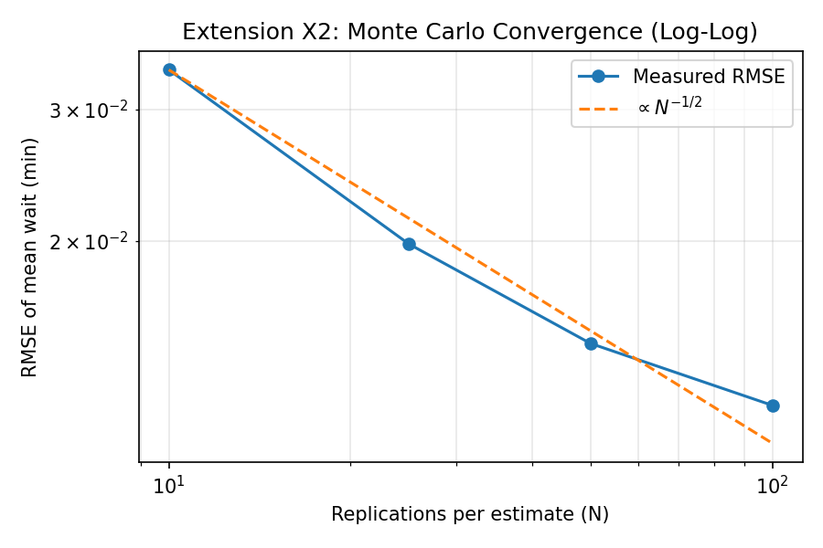

# Stadium Gate Security Queue Simulator

Simulate stadium entry gate security queues across lane counts with confidence intervals to balance spectator waiting times, forecourt queue safety, and lane staffing.

- **Live Web Demo:** https://lahiruranjana.github.io/stadium-gate-queue-simulator/
- **Open in Colab:** 

## Problem and Question
Before major sporting events at large stadiums, spectators arrive in waves and must pass security screening at entry gates. Too few open lanes cause long waits and crowd build-up outside the gates; too many lanes waste staffing capacity. This project asks: what is the minimum number of security lanes per gate that keeps 95th-percentile waiting times below 10 minutes and peak queue lengths within safe forecourt holding capacity?

## Quick Start
1. **Colab Notebook:** Open the Colab link above and select **Runtime -> Run all** (or run locally after installing dependencies in `requirements.txt`).
2. **Web Demo:** Open `docs/index.html` directly in a modern browser, or visit the GitHub Pages URL above.

## User Guide
See [USER_GUIDE.md](USER_GUIDE.md) for parameter controls, interactive scenarios, output definitions, and interface limitations.

## Model and Mathematics Summary
The core checkpoint is modeled as an $M/M/c$ queue with arrival rate $\lambda$, per-lane service rate $\mu$, lane count $c$, and utilization $\rho = \lambda/(c\mu)$, extended to a two-stage surge model via arrival thinning. Full derivations and verification checks are documented in [THEORY.md](THEORY.md).

## Verification
The simulator is checked against exact steady-state Erlang-C queue wait ($W_q$) and wait probability ($P_w$), a zero-arrival limiting check, people conservation invariants, and Monte Carlo error scaling across replication counts $N$.

## Concepts Applied
This project applies next-event time-advance discrete-event simulation, inverse-transform exponential variate generation, non-homogeneous arrival thinning, two-stage queueing network flow, and multi-seed Monte Carlo confidence intervals with $N^{-1/2}$ error scaling verified against closed-form Erlang-C steady-state results.

## Results, Limitations and Future Work
At $\lambda = 18$ spectators/min and $\mu = 3$ spectators/min/lane, $c = 7$ lanes ($\rho = 0.86$) keeps the 95th-percentile wait at $0.78\text{ min}$ (95% CI: $[0.66, 0.90]\text{ min}$) and peak queue around $26.5$ spectators (95% CI: $[23.6, 29.3]$). Limitations include synthetic/literature-grounded parameters, exponential service assumptions, and single-gate abstraction; future work can incorporate empirical gate logs, multi-gate diversion, and spatial pedestrian dynamics.

## Key References
Full details and links are provided in [REFERENCES.md](REFERENCES.md), including Law (2015), Kleinrock (1975), Helbing and Molnár (1995), Helbing, Farkas, and Vicsek (2000), and Burstedde et al. (2001).

## AI Assistance Note
Generative AI tools were used to assist with mathematical drafting, code scaffolding, web demo structure, and documentation editing; all equations, assertions, outputs, and claims were manually verified. Detailed interaction logs and reflections are kept separately in private documentation.

## Licence and Data Credits
Released under the MIT License (see [LICENSE](LICENSE)). Parameters are synthetic and literature-grounded rather than collected from personal or identifiable crowd data.
